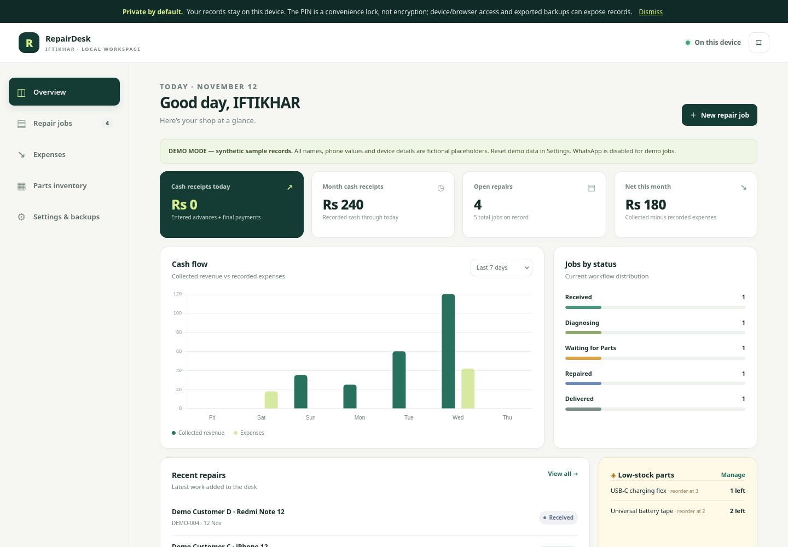
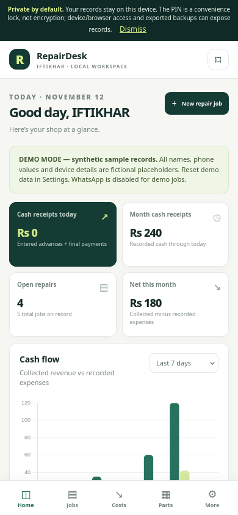
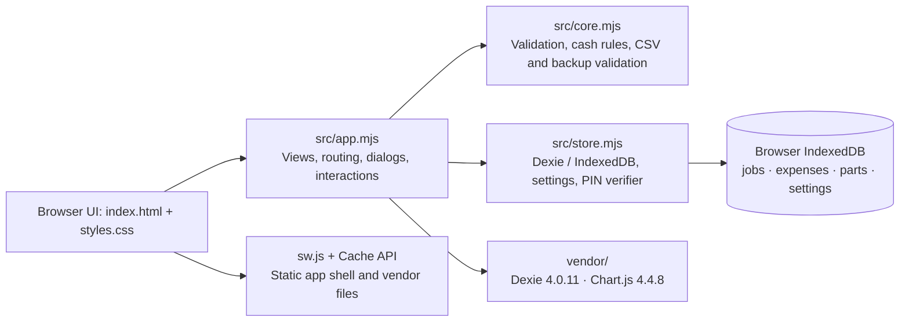

# RepairDesk

[](https://github.com/specter-sec/repairdesk/actions/workflows/pages.yml)

**A small, offline-first repair-shop desk for IFTIKHAR.** Track repair jobs, cash actually collected, shop expenses, and a simple parts list from one browser—without an account or remote data service.

- **Maintainer:** IFTIKHAR
- **Repository:** [specter-sec/repairdesk](https://github.com/specter-sec/repairdesk)
- **Live app:** [specter-sec.github.io/repairdesk](https://specter-sec.github.io/repairdesk)
- **License:** MIT (see [`LICENSE`](LICENSE))

RepairDesk is a static, client-side web app. Records are stored in the current browser profile on the current device. The app does not provide cloud sync, a server-side account, or a shared multi-user workspace.

> **Important privacy and data note:** The PIN is a convenience lock, not encryption. Repair and customer records are stored locally in readable browser storage; exported files are plaintext. Anyone with access to the device/browser profile or developer tools may be able to read them. Keep regular backups somewhere secure.

For real customer records, prefer a dedicated HTTPS origin and a browser profile you control. GitHub Pages project paths under the same account share an origin; see the [security model and safe-use guidance](SECURITY.md) before entering sensitive information.

## What it does

- **Repair jobs:** Create and edit jobs with customer name and phone, device model, optional IMEI and accessories, fault description, estimate, advance, final balance actually collected, and one of five statuses: Received, Diagnosing, Waiting for Parts, Repaired, and Delivered. Search records by customer, phone, model, IMEI, fault, or job ID; filter by status.
- **Receipts:** Open a print preview and print from the browser. Phone and IMEI can be redacted using the workspace preference or the individual receipt control. A receipt is an estimate/record for the repair desk—not a compliant tax invoice or proof that the displayed estimated balance was paid.
- **WhatsApp handoff:** Review a prefilled status message in English or Roman Urdu, then explicitly choose to open a WhatsApp chat. RepairDesk opens the chat; it does **not** send messages automatically. Demo records cannot launch WhatsApp.
- **Cash and expenses overview:** See recorded receipts, recorded expenses, a simple net figure, cash-flow charts, job-status counts, recent jobs, and low-stock alerts. The dashboard is a lightweight operational summary, not a complete accounting system.
- **Expenses:** Record a description, category, amount, and date paid.
- **Parts inventory:** Maintain part names, whole-number quantities, and per-part low-stock thresholds. Inventory is not linked to individual jobs and does not automatically consume stock.
- **Currency display:** Defaults to **PKR**. The supported choices in Settings are PKR, USD, GBP, EUR, and AED. Changing the display currency does not convert stored amounts or exchange rates.
- **Synthetic demo data:** Optionally load clearly labeled fictional sample records or clear local records from Settings. Demo data is not inserted automatically.
- **Data portability:** Export jobs as CSV, or download a JSON backup containing jobs, expenses, parts, and non-PIN settings. Imports are validated and require confirmation before replacing records. Details are below.

### How the cash totals work

The app counts an entered job advance as a receipt on the job's `createdAt` date. It counts `balanceCollected` separately only when the job status is **Delivered**, using `deliveredAt` (or the recorded fallback timestamp). Estimates and balances not actually entered as collected are not income in these totals. Expense dates use the date entered for the expense. The dashboard's “net” is collected cash minus recorded expenses for the selected period; it is not a formal profit calculation or accounting ledger. Do not rely on these summaries for tax filing, statutory books, or accounting compliance.

## Screenshots

Actual browser captures of the running app: a 1440 × 1000 desktop dashboard and a 390 × 844 phone view. All displayed records are clearly labeled synthetic demo fixtures; no customer data or PIN is shown.





To reproduce, start the local server, create your own temporary PIN, and use **Settings & backups → Load synthetic demo data**. The confirmation replaces local records, so export anything you need first. Return to Overview before capturing. Browser smoke checks covered job intake and statuses, currency-aware forms and WhatsApp previews, A5 print isolation and redaction, modal keyboard focus, expense/inventory updates, JSON export/restore, offline reload, PIN rejection/unlock, and all five mobile views without horizontal overflow. These browser checks are separate from the automated Node unit tests.

## Run locally

No build step or package installation is required to serve the app. Use Python 3 from the repository root:

```sh
python3 --version
python3 -m http.server 8000
```

Then open <http://localhost:8000> in a modern browser. Keep the server running while using the app. `localhost` is treated as a secure context by browsers for the service-worker and cryptography APIs used here. For access from another device, use an HTTPS host; a plain HTTP connection to a LAN IP may not permit those APIs or PWA features.

On first visit, load the app while online so the browser can fetch the static files and install the service worker's app-shell cache. Create a 4–12 digit local PIN when prompted. Your first real workspace starts empty; sample data is optional.

### GitHub Pages

The repository includes a GitHub Actions workflow that runs syntax checks and Node tests on pushes and pull requests to `main`. On a push to `main` or manual workflow dispatch, after checks pass, it stages the static files and deploys them to GitHub Pages. For a fork, configure GitHub Pages to use **GitHub Actions** in repository Settings, then use the fork's Pages URL. The configured project URL for this repository is <https://specter-sec.github.io/repairdesk>.

### Install as an app (optional)

The app includes a web app manifest and service worker. Visit its HTTPS Pages URL (or a local `localhost` URL) at least once while online. Then use the browser's own install option—for example, **Install app** in supported desktop Chromium browsers, **Add to Home Screen** in Safari on iOS/iPadOS, or **Install app / Add to Home screen** in supported Android browsers. The wording and availability depend on browser and OS; installation is not required to use the site.

## Offline use, storage, and backups

The service worker caches the static app shell and local vendor libraries. Following a successful online first load/cache installation, previously cached app files can be served offline; this does not synchronize records or make them available on another device. Browser storage is managed by the browser and may be cleared by the user, browser cleanup, profile removal, or storage pressure/eviction. A cache is not a backup, and a fresh browser/profile may need to load the app online first.

Use **Settings & backups → Download JSON backup** regularly, and keep a copy outside the device/browser profile. JSON backups are plaintext and can contain customer names, phone numbers, IMEIs, job details, expenses, inventory, and preferences. Protect them accordingly. The backup excludes the local PIN verifier and salt.

- **JSON import:** The file is validated, then requires confirmation. It replaces the current jobs, expenses, and parts, and restores its included non-PIN settings. The PIN belonging to the current browser is retained.
- **CSV import:** Only the app's jobs CSV format is accepted and validated. After confirmation, it replaces jobs only; existing expenses and parts remain. The current browser's PIN remains.
- Imports are destructive replacements for the indicated data. Save a backup before importing. CSV is for jobs only, not a complete backup.

## Architecture

RepairDesk uses browser-native JavaScript modules and IndexedDB; there is no application server or build/bundling step. Dexie provides the IndexedDB interface, and the locally bundled Chart.js draws the dashboard charts.



The PIN is derived with PBKDF2-HMAC-SHA-256 using a random 16-byte salt and 310,000 iterations; the stored values are a verifier, salt, and iteration count, not the PIN itself. This does not encrypt IndexedDB, encrypt backups, or provide brute-force resistance. The app also locks its UI after five minutes without observed activity, but that is only a convenience guard on the interface.

## Development and checks

Requirements: Node.js 20 or later. From the project root:

```sh
npm run check
npm test
```

`npm run check` runs Node syntax checks for the app, core, store, and core tests. `npm test` runs the pure-core tests with Node's built-in test runner. These commands are documented for contributors; consult the current CI run for the result on a particular revision. See [`CONTRIBUTING.md`](CONTRIBUTING.md) for manual browser smoke checks.

## Current limitations and possible next steps

This is intentionally a modest, single-browser tool. It has no account system, remote sync, multi-user access, cloud recovery, payment processing, automated message sending, or job-linked stock movements. Storage can be lost if browser data is cleared or evicted, so users must manage their own backups. Its totals and receipts are not substitutes for accounting, tax, or invoice-compliance software.

Possible future work (not promises or implemented features): improve accessible/mobile browser QA; add explicit backup reminders or a more guided restore flow; provide clearer data-retention/export controls; and evaluate carefully scoped, optional ways to share data without weakening the local-first privacy model.

## Third-party software

- [Dexie 4.0.11](https://github.com/dexie/Dexie.js) — Apache License 2.0; bundled license: [`vendor/DEXIE-LICENSE.txt`](vendor/DEXIE-LICENSE.txt).
- [Chart.js 4.4.8](https://www.chartjs.org/) — MIT License; bundled license: [`vendor/CHARTJS-LICENSE.md`](vendor/CHARTJS-LICENSE.md).

RepairDesk itself is distributed under the MIT License; see [`LICENSE`](LICENSE).
